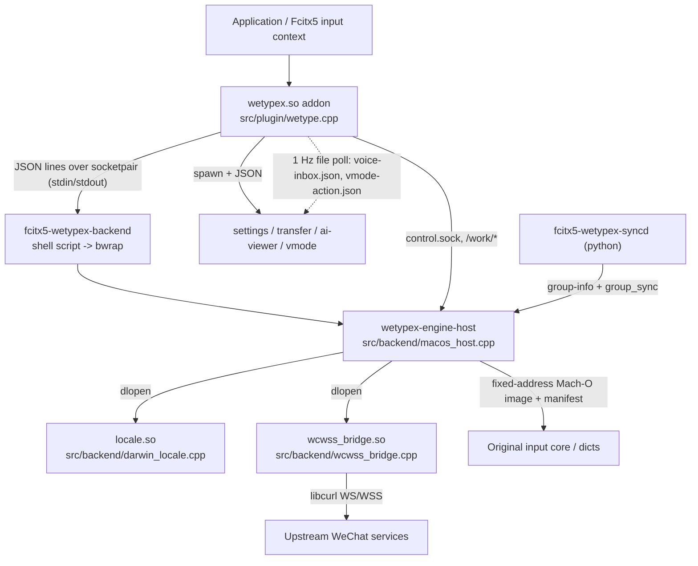

# Repository Guidelines

Guidance for AI coding assistants working in this repo. Docs are written in Chinese; code identifiers and comments are English. Keep new docs/UI strings in Chinese, code in English.

## Project Overview

WeTypeX is an unofficial, non-Tencent project that runs the proprietary WeChat Input Method (微信输入法) input core on Linux through Fcitx5. It does not emulate Windows/Wine/VM: `fcitx5-wetypex-setup` verifies a **pinned** official macOS package (`2.2.3.657`), extracts the input core, dictionaries and Flurry/WXP2P libraries into a fixed-address loadable image plus relocation manifest, and `wetypex-engine-host` supplies the Darwin C/C++ ABI the core expects. Networking is bridged to Linux libcurl/TLS/WebSocket.

Status: early development, tested only on Arch Linux + KDE Plasma + Wayland. See `docs/feature-status.md` (可用 / 预览 / 不提供) and `README.md`.

**Project invariants — violating these is a bug, not a design choice** (`CONTRIBUTING.md`):

- Never commit upstream packages, binaries, dictionaries, models, account data, or generated artifacts.
- Never fake candidates, login, pairing, sync, voice, AI, or transfer success; never simulate success states.
- Never bypass account verification or replace official services.
- Scrub UIN, device codes, transfer codes, clipboard contents, and private text from logs, tests, and examples.
- ABI struct changes must document the applicable upstream version, compatibility range, and failure boundary.
- Never weaken or bypass the upstream archive/binary SHA-256 pins.

## Architecture & Data Flow

The plugin is a thin JSON-RPC client; the real engine is an opaque Mach-O image executed in a `bubblewrap` sandbox. Nothing in `src/` is a normal input-method engine.



Data-flow specifics worth knowing before editing:

- **Channels:** (1) `socketpair` stdin/stdout between addon and engine host, one JSON object per line; (2) Unix socket `<state>/control.sock` (`src/backend/control.hpp`), which **only** accepts `hotword_list`, `hotword_set`, `group_sync` — every other op returns `management operation not allowed`; (3) files polled at 1 Hz (`voice-inbox.json`, `vmode-action.json`); (4) `QProcess` JSON lines for the Qt apps; (5) DBus only for `org.fcitx.Fcitx5 /controller` `ReloadAddonConfig`.
- **Reply correlation:** every request carries `session`, `seq`, `epoch`, `revision`. Stale replies are dropped by epoch/seq; candidate selection is guarded by revision snapshots so async cloud candidates cannot change the committed word.
- **The addon sends a full ~40-key config snapshot on every keystroke** — adding a config key means touching the snapshot builder too.
- **Sandbox contract:** the host is only runnable inside `bwrap`; absolute paths `/work`, `/work/control.sock`, `/work/user`, `/work/userDict`, `/work/business`, `/input/resources/` are bind-mount targets. Do not "fix" them to real filesystem paths.
- **Fixed-address assumptions:** the Mach-O image is mapped with `MAP_FIXED_NOREPLACE` at addresses from `manifest.txt`; constructor filtering, stack guard, TLS layout, struct sizes and field offsets are bound to upstream `2.2.3.657`. `static_assert`s guard sizes; the numeric offsets are not derivable from source.
- **Two stdlib worlds:** most code is g++/libstdc++, but `src/backend/wcwss_bridge.cpp` and `src/backend/darwin_locale.cpp` **must** be built with `clang++ -stdlib=libc++` (raw `add_custom_command`s in `CMakeLists.txt`) because `std::string`/libc++ objects cross the dlopen boundary. Never move them to a normal g++ target or change their types.

## Key Directories

| Path | Contents |
| --- | --- |
| `src/plugin/` | `wetype.cpp` (the Fcitx5 addon, `FCITX_ADDON_FACTORY`), `config.hpp` (RawConfig schema + UI strings) |
| `src/backend/` | `macos_host.cpp` (Darwin ABI host + all dev modes), `service.hpp` (input session loop), `business_services.hpp` (cloud RPC / protobuf), `control.hpp` (control socket), `wcwss_bridge.cpp`, `darwin_locale.cpp` |
| `src/settings/`, `src/transfer/`, `src/ai/`, `src/vmode.cpp`, `src/clipboard/` | Qt5/Qt6 GUI apps and the clipboard CLI helper |
| `src/configui/` | Fcitx5 Qt config-UI plugin (`libwetypexconfig.so`); `wetypexconfig.json` must stay next to `main.cpp` (moc metadata) |
| `src/common/` | `json.hpp` — a local RAII facade over system json-c (**not** a vendored library); `qt_helpers.hpp` — Qt5/6 helpers |
| `scripts/` | `*.sh.in` templates `configure_file`d into the `fcitx5-wetypex-*` launchers; `setup_runtime.py` (runtime extraction, SHA pins) |
| `tools/` | `prepare_macos_runtime.py` (Mach-O → fixed-address image; **also used at user setup time**), `package_release.py` (source tarball + `dist/arch/PKGBUILD`) |
| `cmake/` | `BundledCurl.cmake` (curl 8.22.0 pin), `BundledOpenSSL.cmake` (OpenSSL 3.5.5) |
| `packaging/` | `stage.sh`, `container-stage.sh`, `build-packages.sh`, `build-native-packages.sh`, `nfpm.yaml`, `PKGBUILD.in`, `aur/`, `docker/` |
| `data/` | Fcitx5 addon/inputmethod confs, icons, themes, `wetypex-symbols.json` (V-mode symbol table) |
| `docs/` | `architecture.md`, `configuration.md`, `distribution.md`, `feature-status.md`, `troubleshooting.md` (Chinese) |

## Development Commands

```bash
# configure + build (x86-64 only; clang++ required for the libc++ ABI shims)
cmake -S . -B build -DCMAKE_BUILD_TYPE=Release -DCMAKE_INSTALL_PREFIX=/usr
cmake --build build --parallel

# install
sudo cmake --install build

# useful options
-DWETYPE_QT_VERSION=AUTO|5|6      # default AUTO: prefer complete Qt6, else Qt5
-DWETYPE_BUNDLED_CURL=OFF         # link system libcurl>=8.9 instead of the pinned static build
-DWETYPE_BUNDLED_OPENSSL=ON       # private static OpenSSL 3.5.5 for the bundled curl
-DFETCHCONTENT_SOURCE_DIR_KQUEUE=/path/to/libkqueue   # offline builds (used by PKGBUILD)

# pre-submit checks (CONTRIBUTING.md); there is no test suite
for script in scripts/*.sh.in; do
  case "$script" in *-syncd.sh.in|*-update.sh.in|*-sync.sh.in) continue;; esac
  sh -n "$script"
done
python3 -m py_compile scripts/setup_runtime.py tools/*.py \
  build/fcitx5-wetypex-syncd build/fcitx5-wetypex-update build/fcitx5-wetypex-sync

# packaging (needs docker + nfpm + makepkg + zstd)
packaging/build-packages.sh
python3 tools/package_release.py && (cd dist/arch && makepkg -C -f --noconfirm)
```

Runtime smoke checks (the only real verification available):

```bash
fcitx5-wetypex-setup --archive /path/to/WeType_2.2.3_657.zip   # or --download --accept-upstream-license
fcitx5-wetypex-setup --check            # exit 1 unless core_ready: true; validates under bwrap
fcitx5-wetypex-account network-info     # exit 0 only if ws: true and wss: true
fcitx5-diagnose | less                  # plugin search path
QT_QPA_PLATFORM=offscreen timeout 3 fcitx5-wetypex-settings   # CI asserts exit code 124 (GUI stayed alive)
```

`WETYPE_DEBUG=1` keeps backend stderr; other undocumented overrides: `WETYPE_HOST_DEBUG`, `WETYPE_DEBUG_NETWORK`, `WETYPE_BACKEND_LAUNCHER`, `WETYPE_SYNCD_LAUNCHER`, `WETYPE_UPDATE_{API,DIR,NO_NOTIFY}`, `WETYPE_STATE_DIR`, `WETYPE_RUNTIME_DIR`, `WETYPE_SUPPORT_DIR`, `WETYPE_PYTHON`, `WETYPEX_BUILD_JOBS`.

## Code Conventions & Common Patterns

- **Formatting:** `.editorconfig` is advisory (nothing enforces it): UTF-8, LF, final newline, no trailing whitespace; **2-space indent for C/C++**, 4-space for Python/Shell, Markdown exempt from trailing-whitespace trimming. There is no `.clang-format`, `.clang-tidy`, or linter config.
- **Naming:** types `PascalCase`; functions `camelCase` in the plugin/Qt code but `snake_case` in the C-style backend (`service_loop`, `shim_*`, `run_flurry_server`); class members `trailing_underscore_` in plugin/Qt classes, **no suffix** in backend structs; file-scope globals `snake_case`; constants `k`-prefixed (`kPunctuation`, `kGreen`); files `snake_case` (`macos_host.cpp`), `main.cpp` per helper binary. `src/plugin/config.hpp` and `src/settings/main.cpp` hold user-visible Chinese UI strings; identifiers stay English.
- **Headers:** `#pragma once` everywhere; no include guards. Local includes first, blank line, then one alphabetized block of `<Qt…>` + std + POSIX.
- **Qt:** dual Qt5/Qt6 via `QT_VERSION_CHECK`; no `Q_OBJECT`/signals-slots macros outside `src/configui/main.cpp` — use `QObject::connect(&sender, &Type::signal, this, lambda)`. `QString` in Qt code, `std::string` in addon/backend, convert only at boundaries.
- **Error handling:** no exceptions for control flow (one `try/catch`, around `_wxime_initialize`). Backend hard-exits with distinct codes (`_exit(86…93)`, `78` when the manifest is missing) after logging `UNSUPPORTED …`; the plugin returns `bool`, applies exponential restart backoff (250 ms → 30 s), and surfaces failures as input-panel status text. Qt IPC helpers return `{"error": "…"}` objects.
- **No `assert()` and no `qDebug`/`qWarning`** anywhere. Logging is `fprintf(stderr, …)` gated by env vars; correctness relies on `static_assert` for ABI sizes.
- **Threading:** the addon uses only the Fcitx event loop (IO events + 100 ms timer); the host is a single-threaded `poll()` loop; threads exist only in `wcwss_bridge.cpp` (one per WS connection) and inside the Mach-O core; Qt apps use `QProcess` + `QTimer`.
- **Config/state:** `~/.config/fcitx5/wetypex.json` is the single source of truth for both the plugin and the settings app — flat snake_case keys, no schema/version field, values clamped/validated on read, mirrored to Fcitx `RawConfig`. **Every key is duplicated in three places**: the plugin's read path (`wetype.cpp`), the plugin's write path (`wetype.cpp`), and the settings UI (`settings/main.cpp`), plus `src/plugin/config.hpp` for the Fcitx config page. All file writes are tmp-file + `chmod 0600` + `rename` (`QSaveFile` in Qt).
- **No dependency injection, no singletons beyond the Fcitx addon factory**; shared helpers are `inline` free functions in headers.
- **Comments carry reverse-engineering evidence** ("Recovered from macOS 2.2.3.657 …", magic offsets). Do not delete them as "noise"; they are the only rationale for the constants.
- **Commits:** English, imperative, sentence case, no prefix convention (`Fix V toolbar focus…`, `Bump packaging revision to 9`). PRs use `## 改动 / ## 验证 / ## 兼容性与限制` (`.github/pull_request_template.md`) and must state the checks actually run.

## Important Files

| File | Why it matters |
| --- | --- |
| `CMakeLists.txt` | Single build definition; version literal, `pkgrel` regex-parsed from `PKGBUILD.in`, all targets, compile-time absolute install paths (`WETYPE_*` defines) |
| `src/plugin/wetype.cpp` | The addon: key handling, config load/save, candidate/panel logic, child-process launch |
| `src/backend/macos_host.cpp` | Darwin ABI shim table, image loader, and all 13 dev modes (`validate`, `network-info`, `business-service`, `llm-service`, `flurry-*`, `wxp2p-probe`, …) |
| `src/backend/service.hpp`, `business_services.hpp` | ABI mirrors of the core's session and cloud-RPC structs (magic offsets, `static_assert`ed sizes) |
| `scripts/setup_runtime.py` | Upstream URL + `ARCHIVE_SHA`/`ENGINE_SHA`/`FLURRY_SHA`/`WXP2P_SHA` pins; `--check` validation runs the host under `bwrap` |
| `scripts/fcitx5-wetypex-backend.sh.in` | Defines the `bwrap` sandbox, lock file, and offline (`--unshare-net`) policy |
| `scripts/fcitx5-wetypex-syncd.sh.in` | Sole system-clipboard writer/uploader; owns the device-group version cursor |
| `data/wetypex-addon.conf.in`, `data/wetypex-inputmethod.conf` | Fcitx5 registration (`Library=wetypex`, addon name `wetypex`) |
| `packaging/nfpm.yaml`, `packaging/PKGBUILD.in`, `tools/package_release.py` | Package metadata; `release: "9"` / `pkgrel=9` are duplicated and must be bumped together |
| `.github/workflows/build.yml` | The de-facto quality gate (build + script syntax + deb install smoke) |

## Runtime/Tooling Preferences

- **Toolchain:** CMake ≥ 3.16, C++17 baseline (`CMAKE_CXX_STANDARD 17`); the `wetypex` addon target is bumped to C++20 **only** when `Fcitx5Core >= 5.1`. `README.md` and `CONTRIBUTING.md` claim C++20 unconditionally — the CMake base is authoritative.
- **Compiler:** `clang++` is a hard requirement (`find_program(... REQUIRED)`) for the libc++ ABI shims; the rest of the tree can use g++.
- **Platform:** Linux **x86-64 only** — `CMakeLists.txt` hard-fails on other processors; there is no aarch64 path despite the Darwin-ABI design.
- **Package manager:** distro-native (`pacman`/`apt`/`dnf`); no vendored dependency manager. `libkqueue` is fetched from GitHub at a pinned commit — offline builds must pass `FETCHCONTENT_SOURCE_DIR_KQUEUE`. Bundled curl 8.22.0 is the default transport; keep its pin in sync with the PKGBUILDs.
- **Install-time path baking:** `WETYPE_LAUNCHER`, `WETYPE_SETTINGS`, `WETYPE_SYNCD`, `WETYPE_ACCOUNT_TOOL`, `WETYPE_AI`, `WETYPE_VOICE`, `WETYPE_VMODE`, `WETYPE_UPDATE` are absolute paths compiled in; changing `CMAKE_INSTALL_PREFIX` requires a re-configure, not just a re-link. `FCITX_INSTALL_ADDONDIR` comes from the Fcitx5 CMake package (distro-dependent `lib`/`lib64`).
- **Version bumps touch six places:** `CMakeLists.txt` (`VERSION`), `packaging/PKGBUILD.in` (`pkgver`, `pkgrel`), `packaging/aur/PKGBUILD`, `packaging/nfpm.yaml` (`release`), `tools/package_release.py` (`version`), `scripts/setup_runtime.py` (upstream URL/hashes), plus README examples. `docs/distribution.md` lists the checklist but omits the two `scripts/`/`tools/` files.
- **Naming trap:** `fcitx5-wetypex-{backend,account,sync,syncd,setup,ai,voice,update}` are **launcher scripts**; `fcitx5-wetypex-{settings,clipboard-set,ai-viewer,transfer,vmode}` are compiled binaries. `scripts/*.sh.in` also lies about its language: `-sync`, `-syncd`, `-update` are Python (hence the `sh -n` exclusions).

## Testing & QA

**There is no test suite.** No test directory, no framework (gtest/Catch2/QtTest), no `enable_testing()`/`add_test()`, no ctest, no fixtures. `ENABLE_TESTING` is force-set to `OFF` in `CMakeLists.txt` and dependency tests are disabled in the dockerfiles. Do not claim a change is "tested" by a suite that does not exist, and do not add a one-off test framework without being asked.

What stands in for tests:

- **CI (`.github/workflows/build.yml`, on push to `main` and all PRs):** `arch-linux` (Qt6 build + `sh -n`/`py_compile` gate + `makepkg` with LTO), `ubuntu-jammy-deb` (Qt5 build in `packaging/docker/debian.Dockerfile`, asserts `libwetypexconfig.so` exists, produces the deb), `deb-runtime` (installs the deb on Ubuntu 22.04/24.04/26.04 + Debian bookworm/trixie, runs `fcitx5-wetypex-account network-info`, then asserts the offscreen settings GUI survives 3 s), `ubuntu-focal-legacy` (Ubuntu 20.04 with a pinned stable SDK). `release.yml` (tags `v*`, `workflow_dispatch`) only builds, packages, checksums, publishes, and pushes AUR — it runs nothing.
- **In-tree self-checks, mostly manual:** `fcitx5-wetypex-setup --check` exercises `wetypex-engine-host` under `bwrap` in `validate`, `flurry-credentials`, `module-run`, `flurry-wxp2p-server` modes; `network-info` dlopens `locale.so`/`libkqueue.so`/`wcwss_bridge.so` and requires WS **and** WSS. `flurry-loopback` (real loopback send/recv) and `wxp2p-probe` modes exist but are not wired into CI or `--check`.
- **Integrity gates:** SHA-256 pins on the upstream archive and each extracted binary; `tools/package_release.py` rejects any binary (`.so`, `.deb`, `.zip`, `.pyc`, …) in the source tree; `release.yml` asserts the tag equals `v${version}-${pkgrel}`.
- **No coverage, sanitizers, static analysis, lint, or format enforcement.** `-Wall -Wextra` applies to exactly two targets (`wetypex-engine-host`, `wetypex`); there is no `-Werror` anywhere. Warnings in the ~7 Qt/CLI targets are unchecked.
- **Because the plugin is never functionally exercised in CI, verify by hand:** build and install, run `fcitx5-wetypex-setup --check`, reload Fcitx5 (`fcitx5-remote -r`), then exercise the changed path in a real Fcitx5 session (typing, candidates, settings entry) and report exactly what you ran. `docs/distribution.md`'s release checklist lists the manual steps; `fcitx5-diagnose` and the per-feature logs (`state/last-network.log`, `state/voice/last-record.log`, `state/transfer/transport.log`) are the diagnostic entry points.
